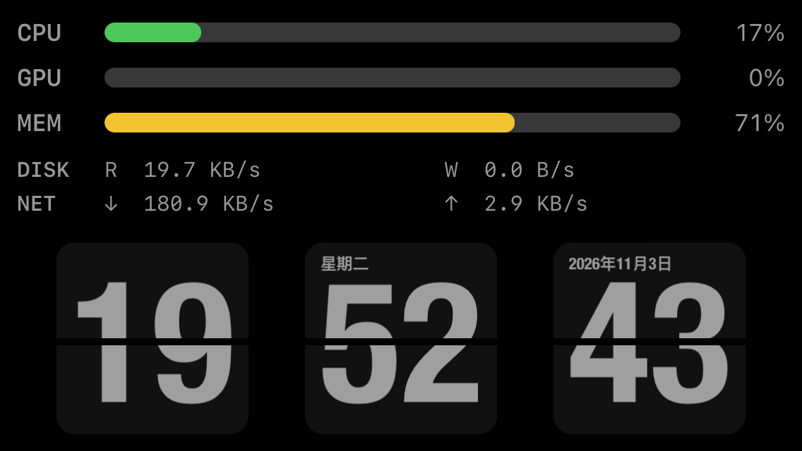

# iphone-screen-stats

把一台常亮、长期插电的 **iPhone SE（第一代，4 寸）** 变成 **Mac mini** 的状态副屏。

- 上半屏：CPU / GPU / 内存 三条百分比进度条，加磁盘读写、网络读写两组速率
- 下半屏：翻页时钟（时:分:秒）+ 年月日 + 星期几

两个进程，一个仓库：Mac 上跑一个 Swift 采集**服务端**，iPhone 上跑一个原生 iOS **客户端**，中间只有一条 `GET /api/stats` 的 1 Hz 轮询。

```
Mac mini ──[ 采集 ]──▶ 最新采样 ──[ NWListener :8737 ]──▶ iPhone ──[ 1 Hz 轮询 ]──▶ 渲染
```



*上图为真机截图（1136×640 px，即 568×320 pt @2x），由 `pymobiledevice3 developer screenshot` 抓取后旋转 270° 得到。*

## 文档

| 文档 | 内容 |
|---|---|
| [docs/design.md](docs/design.md) | 架构、采集实现映射、界面规格、失败模式 |
| [docs/protocol.md](docs/protocol.md) | 线协议契约：端点与 JSON schema |
| [docs/roadmap.md](docs/roadmap.md) | 实施顺序与每一步的验收标准 |
| [docs/adr/](docs/adr/) | 决策记录 |
| [GLOSSARY.md](GLOSSARY.md) | 本项目术语 |
| [AGENTS.md](AGENTS.md) | 给编码 agent 的仓库指南 |

## 跑起来

```bash
make server        # 前台跑服务端（Ctrl-C 退出）
./start.sh         # 或装成 launchd 常驻服务，开机自启
make ios-device    # 编译并装进真机（手机要插在 USB 上）
ipconfig getifaddr en0   # 查 Mac 的局域网 IP，填进手机设置页
```

完整命令见 `make help`；硬约束与真机工具链见 [AGENTS.md](AGENTS.md)。

**Mac 的 IP 不进代码，也不进文档。** 客户端没有任何硬编码地址，服务器地址只从手机上的设置页（长按 2 秒）写入 `UserDefaults`，代码里唯一的缺省值是端口 `8737`。换网段、换静态地址，都只需要在手机上改一次。

## 状态

M0–M6 已完成并复核：服务端采集与 HTTP 端点、客户端骨架与指标区、设置页、服务端 launchd 自启、客户端续签任务。**现在这台 iPhone 上跑的就是它**——CPU / GPU / MEM 进度条、DISK / NET 速率、翻页时钟与日期星期都在，画面见上方实机截图。

剩下 M7 的整日端到端验收，以及真机上的故障态验收和真·重启测试。详见 [docs/roadmap.md](docs/roadmap.md)。
